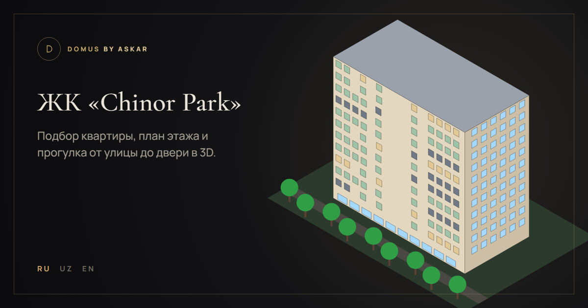
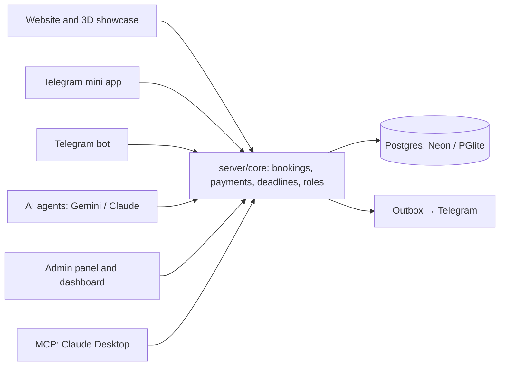
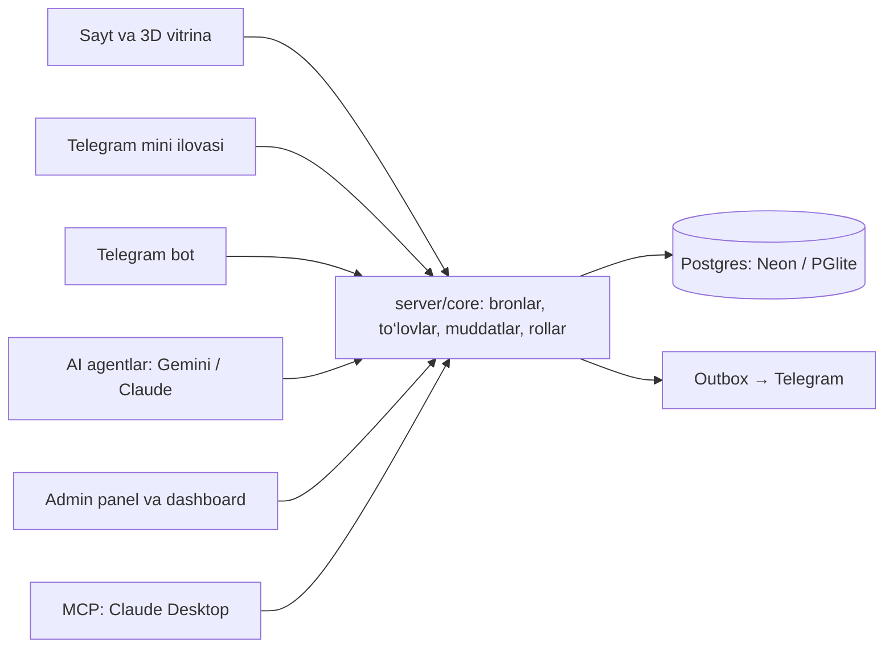
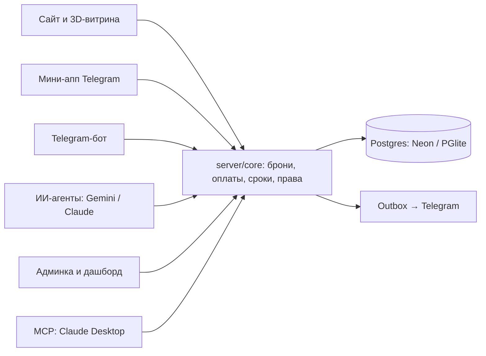

# Domus Estate — Chinor Park

**[English](#english) · [O‘zbekcha](#ozbekcha) · [Русский](#русский)**

**Live demo:** https://domus-askar.vercel.app



---

## English

### About

Domus Estate is a sales platform for a new residential building, built on top of the Domus 3D furniture planner. A buyer picks an apartment on a 3D model of the building, walks through it in first person, furnishes it, books it with a deposit and pays online. An AI consultant answers on the website and in Telegram. Managers work in the admin panel, and the head of sales follows a live dashboard and can ask Claude Desktop about bookings through MCP.

> **This is an educational / test project.** The “Chinor Park” residential complex and the “Chinor Development” developer are fictional. Addresses, phone numbers and bank details are made up. Payments go through emulators and Stripe test mode: no real money is charged and card data is not stored.

### One core, many entry points

All business rules (apartment statuses, holds, bookings, deadlines, payments, refunds, roles) live in `server/core/`. The website, the Telegram mini app, the bot, the AI agents, the admin panel, the dashboard and the MCP server only call the core. A double booking or a payment that bypasses the rules is impossible from any entry point.



### Features

**Showcase and 3D**
- A 3D model of the 12-storey building made from the real floor plans: stone facade, balconies, rooms visible behind the windows, day / evening / night, landscaped grounds with trees, parking and a playground.
- Filters by rooms, area, price and status; floor plans, apartment cards with price per m².
- First-person walk from the street through the lobby, the lift or the stairs to the floor corridor and into any free or booked apartment.
- Every apartment opens in the planner: rooms, furniture, finish level (rough / white box / finished), lighting scenes, photo textures.
- Three languages: English, Uzbek, Russian (`/en`, `/uz`, `/ru`).

**Furniture planner** (`/ru/planner`)
- 2D plan with sizes in centimetres, drag and drop, snapping, rotation and validation: walls, plinth, overlaps, minimum gaps, door swings, opening zones of doors and drawers, narrow passages.
- 3D view with an orbit camera and a first-person walk, opening doors and drawers with collision checks.
- Projects with several rooms, whole-apartment layouts, room and apartment templates, ready-made furniture kits.
- Materials, configurator (sections, drawers), price estimate, printable order drawing (A4, PDF via the browser).

**Booking and payments**
- A 15-minute hold while the buyer pays, then a 72-hour booking with a 10,000,000 sum deposit (all values are set by the head in the admin panel).
- Up to 2 active bookings per client, extension requests, reminders before expiry, automatic release of expired holds and bookings.
- Payment emulators for UzCard / HUMO (with an SMS code step) and Click (SHOP API protocol: Prepare / Complete with signatures), plus Stripe in test mode.
- Offer acceptance with a versioned text, a PDF booking confirmation with a QR code, refunds.
- Mortgage and installment calculators (12 / 24 / 36 months).

**AI consultant**
- A router sends each message to a specialised agent: lead qualification, apartment search, finance, knowledge base, booking.
- Agents use the same tools as the core (search, calculators, viewing and booking requests). Every change needs an explicit confirmation from the client.
- RAG over a knowledge base in three languages (`kb/`), with source grounding.
- Gemini is the main model, Claude is the fallback; quotas, limits and costs are tracked. Without a Gemini key the chat answers from scripted flows.

**Telegram**
- A bot with the AI consultant and streaming answers, plus a mini app (`/mini`) to browse apartments and bookings.
- Notifications to the staff group with a PDF; a manager takes a client with one tap.

**Staff tools**
- Admin panel (`/admin`): clients, viewings, bookings, payments, refunds, AI dialogs, Outbox, settings, staff accounts with roles (manager, head); an analyst agent answers questions about the data.
- Live dashboard (`/dashboard`): sales funnel, bookings, payments and events in real time.
- A test-only time shift in the admin panel to show deadlines and reminders without waiting.
- An MCP server (`/mcp`) for Claude Desktop with two roles: client and head.

### Tech stack

| Area | Tools |
|---|---|
| Server | Node.js 24, Express, plain ES modules, no build step |
| Database | Postgres: Neon in production, PGlite (in-process) locally and in tests |
| Frontend | HTML, CSS, JavaScript, Canvas 2D, Three.js |
| AI | Google Gemini (`@google/genai`), Anthropic Claude (`@anthropic-ai/sdk`), Gemini embeddings for RAG |
| Integrations | grammY (Telegram), Stripe, Upstash QStash (background jobs), Vercel Blob, MCP SDK |
| Documents | pdf-lib, qrcode |
| Validation | zod |
| Hosting | Vercel (region `fra1`), Neon (`eu-central-1`) |

### Getting started

Requires Node 24 (also works on 22+). API keys are optional: without `DATABASE_URL` the database is PGlite in `.pglite/`, and without a Gemini key the chat uses scripted answers.

```bash
npm ci
cp .env.example .env          # fill SESSION_SECRET, LINK_SECRET, LOG_SALT with long random strings
npm run db:migrate
npm run seed -- --base --demo # apartments, settings and 30 days of demo history
npm run staff -- add --login aziz --name "Aziz" --role head   # asks for the password without echo
npm start                     # http://localhost:3000
```

| Page | Address |
|---|---|
| Showcase | `/en`, `/uz`, `/ru` |
| Planner | `/en/planner` |
| Admin panel | `/admin` |
| Dashboard | `/dashboard` |
| Telegram mini app | `/mini` |
| Health check | `/api/health` |

### Environment variables

All names are listed in `.env.example`. Values are never committed.

| Group | Variables |
|---|---|
| Base | `PUBLIC_URL`, `SESSION_SECRET`, `LINK_SECRET`, `LOG_SALT`, `CRON_SECRET`, `ADMIN_TOKEN` |
| Database | `DATABASE_URL` (Neon; empty → PGlite), `TEST_DATABASE_URL` (for `test:neon`) |
| Telegram | `TELEGRAM_BOT_TOKEN`, `TELEGRAM_BOT_USERNAME`, `TELEGRAM_WEBHOOK_SECRET`, `TELEGRAM_STAFF_CHAT_ID` |
| AI | `GEMINI_API_KEY`, `ANTHROPIC_API_KEY` |
| Payments | `STRIPE_SECRET_KEY`, `STRIPE_WEBHOOK_SECRET` |
| Jobs | `QSTASH_TOKEN`, `QSTASH_CURRENT_SIGNING_KEY`, `QSTASH_NEXT_SIGNING_KEY` |
| MCP | `MCP_HEAD_TOKEN`, `MCP_CLIENT_TOKEN`, `MCP_CLIENT_ID` |

### Tests and checks

| Command | What it does | Needs |
|---|---|---|
| `npm test` | All automated tests (≈ 960) on an in-memory PGlite | Nothing |
| `npm run test:neon` | Parallel bookings and webhook retries on a real Neon database | `TEST_DATABASE_URL` |
| `npm run eval:agents` | 20 control questions for the agents (`eval/agents-control.json`) | `GEMINI_API_KEY` |
| `npm run eval:kb` | Knowledge base retrieval (`eval/kb-golden.json`) | `GEMINI_API_KEY`, after `npm run kb:index` |
| `npm run bench -- --url …` | Performance measurements | Gemini key for the chat |

Other scripts: `npm run tg:setup` (bot webhook and commands), `npm run kb:index` (index the knowledge base), `npm run stripe:check`, `npm run ai:smoke`, `npm run jobs:run`, `npm run mcp:client`, `npm run client:forget` (delete a client’s personal data), `npm run textures` (download photo textures).

### Deploy (Vercel + Neon + QStash)

1. **Neon:** create a project in Frankfurt; put the connection string into `DATABASE_URL` on Vercel.
2. **Vercel:** import the repository. The region `fra1`, the daily cron and the build step are already in `vercel.json`. Add the variables from `.env.example`.
3. **Schema and data before the code:** `node --env-file=.env.neon scripts/migrate.js --yes`, then `npm run seed -- --base --yes` with the same connection string.
4. Push to `main`; Vercel builds and deploys.
5. **Telegram:** `npm run tg:setup` sets the webhook and the bot commands.
6. **Knowledge base:** `npm run kb:index`.
7. **Smoke test:** `/api/health` (database, migrations, Telegram, Stripe, AI), the showcase, a hold and a test payment.

Rollback: Instant Rollback in Vercel. Migrations only add things, so the schema never needs to be rolled back.

### MCP in Claude Desktop

Settings → Developer → Edit Config → `claude_desktop_config.json`:

```json
{
  "mcpServers": {
    "chinor-park": {
      "command": "npx",
      "args": ["-y", "mcp-remote@0.14.3", "https://domus-askar.vercel.app/mcp", "--header", "Authorization:${CHINOR_AUTH}"],
      "env": { "CHINOR_AUTH": "Bearer <MCP_HEAD_TOKEN>" }
    }
  }
}
```

- The token is `MCP_HEAD_TOKEN` (head of sales: bookings, payments, viewings, sales summary, extend or cancel a booking) or `MCP_CLIENT_TOKEN` (a demo client: search, calculators, own bookings and requests). Tokens are set by the owner and are not in the repository.
- Actions that change data work in two steps: a preview first, then the same call with a one-time `confirmToken` after the person says “yes”.
- Locally use `http://localhost:3000/mcp` and add the `--allow-http` flag.
- Check: restart Claude Desktop, find “chinor-park” in the tools list, ask “Which bookings expire tomorrow?”.

More details: [server/mcp/README.md](server/mcp/README.md).

### Test cards

The emulators accept **only** these numbers; any future expiry date (`MM/YY`). The SMS code is shown on the payment page.

| Number | Brand | Result |
|---|---|---|
| `9860 0000 0009 0001` | HUMO | Paid |
| `8600 0000 0006 0001` | UzCard | Paid |
| `5614 0000 0006 0001` | UzCard | Paid (spare) |
| `9860 0000 0000 0000` | HUMO | “Bank declined the payment” |
| `8600 0000 0007 0000` | UzCard | “Bank declined the payment” |
| `8600 0000 0005 0002` | UzCard | “Insufficient funds” |
| `9860 0000 0008 0002` | HUMO | “Insufficient funds” |

- **Click:** the emulator at `/pay/click/<id>` uses the same cards.
- **Stripe:** test mode, card `4242 4242 4242 4242`, any future date and CVC.

Staff accounts for reviewers are not published here.

### 3D controls

| Where | Action | How |
|---|---|---|
| Overview | Rotate / zoom / pan | left mouse / wheel / right mouse |
| Walk | Move | `W A S D` or arrows, `Shift` to run |
| Walk | Look around | mouse (click to capture) or drag |
| Walk | Doors, lift, stairs | `E` or click; lift panel: floor buttons, `Esc` to close |
| 3D | Lamps on / off | `L` or 💡 |
| 3D | Day → evening → night | `N` or ☀ 🌇 🌙 |
| Phone | Move / look | joystick / swipe |
| 2D plan | Rotate / delete / undo | `R` / `Del` / `Ctrl+Z` |

### Performance (local, 28.10.2026)

| Metric | Target | Result |
|---|---|---|
| First chat event | median < 2 s | 0.02 s |
| Full chat answer | median < 8 s | 1.35 s |
| Telegram webhook answer | p95 < 500 ms | 17 ms |
| Core API | p95 < 300 ms | 23–39 ms |
| Event on the dashboard | < 5 s | 0.69 s |

Method and full table: [docs/perf.md](docs/perf.md). Security review: [docs/security-review.md](docs/security-review.md).

### Project structure

```
server.js            Express app: pages, API, webhooks, MCP route
server/core/         business rules: apartments, holds, bookings, payments, refunds, viewings, settings, staff, clock
server/agents/       AI agents: router, prompts, confirmations, grounding
server/ai/           Gemini and Claude clients, model chains, quotas, costs
server/tools/        tools shared by the agents and MCP
server/kb/           knowledge base: chunking, embeddings, search
server/payments/     card emulator, Click, Stripe, PDF confirmation
server/telegram/     bot, webhook, mini app auth (initData)
server/mcp/          MCP server
server/http/         HTTP routes (site, admin, dashboard, payments)
server/db/           migrations
pages/               HTML pages (showcase, booking, payment, admin, dashboard)
public/              frontend: planner, 3D, admin, dashboard, textures
kb/                  knowledge base texts (en / uz / ru)
legal/               offer and privacy policy (en / uz / ru)
scripts/             migrations, seed, staff, Telegram, KB, evals, benchmarks
eval/                control sets and run reports
test/                automated tests (node:test)
```

### Limitations of the test version

- The residential complex, the developer, the address and the bank details are fictional.
- Payments are emulators and Stripe test mode; real cards are never charged.
- The offer and privacy policy (`/legal/offer`, `/legal/privacy`) are sample texts.
- On the free Gemini tier Google may use requests to train its models, so the demo uses test data only.
- All prices are test values.

### Licences

Photo textures: [ambientCG](https://ambientcg.com), CC0. Three.js: MIT.

---

## O‘zbekcha

### Loyiha haqida

Domus Estate — yangi turar-joy binosidagi kvartiralarni sotish platformasi. U Domus 3D mebel rejalashtiruvchisi asosida qurilgan. Xaridor binoning 3D modelida kvartira tanlaydi, uning ichida birinchi shaxs ko‘rinishida yuradi, mebel joylashtiradi, depozit bilan bron qiladi va onlayn to‘laydi. Saytda va Telegramda AI maslahatchi javob beradi. Menejerlar admin panelda ishlaydi, sotuv rahbari jonli dashboardni kuzatadi va MCP orqali Claude Desktop’dan bronlar haqida so‘raydi.

> **Bu o‘quv / test loyihasi.** «Chinor Park» turar-joy majmuasi va «Chinor Development» quruvchisi o‘ylab topilgan. Manzillar, telefonlar va bank rekvizitlari soxta. To‘lovlar emulyatorlar va Stripe test rejimi orqali o‘tadi: haqiqiy pul yechilmaydi, karta ma’lumotlari saqlanmaydi.

### Bitta yadro — ko‘p kirish nuqtasi

Barcha biznes qoidalari (kvartira holatlari, vaqtinchalik ushlab turish, bronlar, muddatlar, to‘lovlar, qaytarishlar, rollar) `server/core/` ichida. Sayt, Telegram mini ilovasi, bot, AI agentlar, admin panel, dashboard va MCP server faqat yadroni chaqiradi. Shuning uchun hech qaysi kirish nuqtasidan ikki marta bron qilish yoki qoidalarni chetlab to‘lash mumkin emas.



### Imkoniyatlar

**Vitrina va 3D**
- 12 qavatli binoning haqiqiy qavat rejalaridan yasalgan 3D modeli: tosh fasad, balkonlar, derazalar ortida ko‘rinadigan xonalar, kunduz / kechqurun / tun, daraxtlar, avtoturargoh va bolalar maydonchasi bilan obodonlashtirilgan hudud.
- Xonalar soni, maydon, narx va holat bo‘yicha filtrlar; qavat rejalari, 1 m² narxi ko‘rsatilgan kvartira kartochkalari.
- Ko‘chadan vestibyul, lift yoki zinapoya orqali qavat yo‘lagiga va istalgan bo‘sh yoki bron qilingan kvartiraga birinchi shaxs ko‘rinishida sayr.
- Har bir kvartira rejalashtiruvchida ochiladi: xonalar, mebel, pardozlash darajasi (qora / oq quti / tayyor), yorug‘lik sahnalari, foto teksturalar.
- Uch til: ingliz, o‘zbek, rus (`/en`, `/uz`, `/ru`).

**Mebel rejalashtiruvchisi** (`/uz/planner`)
- Santimetrdagi o‘lchamlar bilan 2D reja, sudrab tashlash, yopishish, burish va tekshiruv: devorlar, plintus, ustma-ust tushish, minimal oraliq, eshik ochilishi, eshik va tortmalarning ochilish zonalari, tor o‘tish joylari.
- Orbital kamera va birinchi shaxs sayri bilan 3D ko‘rinish, to‘qnashuv tekshiruvi bilan eshik va tortmalarni ochish.
- Bir nechta xonali loyihalar, butun kvartira rejasi, xona va kvartira shablonlari, tayyor mebel to‘plamlari.
- Materiallar, konfigurator (seksiyalar, tortmalar), taxminiy narx, buyurtma chizmasini chop etish (A4, brauzer orqali PDF).

**Bron va to‘lovlar**
- Xaridor to‘layotganda kvartira 15 daqiqa ushlab turiladi, keyin 10 000 000 so‘m depozit bilan 72 soatlik bron (barcha qiymatlarni rahbar admin panelda o‘zgartiradi).
- Bitta mijozga 2 tagacha faol bron, muddatni uzaytirish so‘rovi, tugashidan oldin eslatmalar, muddati o‘tgan bronlarni avtomatik bo‘shatish.
- UzCard / HUMO emulyatori (SMS kod bosqichi bilan), Click emulyatori (SHOP API protokoli: imzoli Prepare / Complete) va Stripe test rejimi.
- Versiyalangan oferta matnini qabul qilish, QR kodli PDF bron tasdig‘i, pulni qaytarish.
- Ipoteka va muddatli to‘lov kalkulyatorlari (12 / 24 / 36 oy).

**AI maslahatchi**
- Router har bir xabarni ixtisoslashgan agentga yuboradi: mijozni aniqlash, kvartira qidirish, moliya, bilimlar bazasi, bron.
- Agentlar yadro bilan bir xil vositalardan foydalanadi (qidiruv, kalkulyatorlar, ko‘rik va bron so‘rovlari). Har qanday o‘zgarish mijozning aniq tasdig‘ini talab qiladi.
- Uch tilli bilimlar bazasi (`kb/`) bo‘yicha RAG, manbalarga tayangan javoblar.
- Asosiy model — Gemini, zaxira — Claude; kvotalar, limitlar va xarajatlar hisobga olinadi. Gemini kalitisiz chat tayyor ssenariylar bo‘yicha javob beradi.

**Telegram**
- AI maslahatchi va oqimli javoblarga ega bot, kvartiralar va bronlarni ko‘rish uchun mini ilova (`/mini`).
- Xodimlar guruhiga PDF bilan bildirishnomalar; menejer mijozni bir bosishda o‘ziga oladi.

**Xodimlar uchun**
- Admin panel (`/admin`): mijozlar, ko‘riklar, bronlar, to‘lovlar, qaytarishlar, AI dialoglar, Outbox, sozlamalar, rollar bilan xodim hisoblari (menejer, rahbar); tahlilchi agent ma’lumotlar bo‘yicha savollarga javob beradi.
- Jonli dashboard (`/dashboard`): sotuv voronkasi, bronlar, to‘lovlar va voqealar real vaqtda.
- Muddat va eslatmalarni kutmasdan ko‘rsatish uchun admin paneldagi test vaqtini surish.
- Claude Desktop uchun ikki rolli MCP server (`/mcp`): mijoz va rahbar.

### Texnologiyalar

| Soha | Vositalar |
|---|---|
| Server | Node.js 24, Express, oddiy ES modullar, yig‘ish bosqichisiz |
| Ma’lumotlar bazasi | Postgres: prodakshnda Neon, lokal va testlarda PGlite |
| Frontend | HTML, CSS, JavaScript, Canvas 2D, Three.js |
| AI | Google Gemini (`@google/genai`), Anthropic Claude (`@anthropic-ai/sdk`), RAG uchun Gemini embeddinglari |
| Integratsiyalar | grammY (Telegram), Stripe, Upstash QStash (fon vazifalari), Vercel Blob, MCP SDK |
| Hujjatlar | pdf-lib, qrcode |
| Tekshiruv | zod |
| Hosting | Vercel (`fra1` mintaqasi), Neon (`eu-central-1`) |

### Ishga tushirish

Node 24 kerak (22+ da ham ishlaydi). Kalitlar majburiy emas: `DATABASE_URL` bo‘lmasa, baza `.pglite/` papkasidagi PGlite bo‘ladi, Gemini kaliti bo‘lmasa, chat ssenariylar bo‘yicha javob beradi.

```bash
npm ci
cp .env.example .env          # SESSION_SECRET, LINK_SECRET, LOG_SALT ga uzun tasodifiy satrlar yozing
npm run db:migrate
npm run seed -- --base --demo # kvartiralar, sozlamalar va 30 kunlik demo tarix
npm run staff -- add --login aziz --name "Aziz" --role head   # parolni yashirin so‘raydi
npm start                     # http://localhost:3000
```

| Sahifa | Manzil |
|---|---|
| Vitrina | `/uz`, `/en`, `/ru` |
| Rejalashtiruvchi | `/uz/planner` |
| Admin panel | `/admin` |
| Dashboard | `/dashboard` |
| Telegram mini ilovasi | `/mini` |
| Holat tekshiruvi | `/api/health` |

### Muhit o‘zgaruvchilari

Barcha nomlar `.env.example` faylida. Qiymatlar repozitoriyga hech qachon qo‘shilmaydi.

| Guruh | O‘zgaruvchilar |
|---|---|
| Asosiy | `PUBLIC_URL`, `SESSION_SECRET`, `LINK_SECRET`, `LOG_SALT`, `CRON_SECRET`, `ADMIN_TOKEN` |
| Baza | `DATABASE_URL` (Neon; bo‘sh → PGlite), `TEST_DATABASE_URL` (`test:neon` uchun) |
| Telegram | `TELEGRAM_BOT_TOKEN`, `TELEGRAM_BOT_USERNAME`, `TELEGRAM_WEBHOOK_SECRET`, `TELEGRAM_STAFF_CHAT_ID` |
| AI | `GEMINI_API_KEY`, `ANTHROPIC_API_KEY` |
| To‘lovlar | `STRIPE_SECRET_KEY`, `STRIPE_WEBHOOK_SECRET` |
| Vazifalar | `QSTASH_TOKEN`, `QSTASH_CURRENT_SIGNING_KEY`, `QSTASH_NEXT_SIGNING_KEY` |
| MCP | `MCP_HEAD_TOKEN`, `MCP_CLIENT_TOKEN`, `MCP_CLIENT_ID` |

### Testlar va tekshiruvlar

| Buyruq | Nima qiladi | Nima kerak |
|---|---|---|
| `npm test` | Barcha avtotestlar (≈ 960), xotiradagi PGlite’da | Hech narsa |
| `npm run test:neon` | Haqiqiy Neon bazasida parallel bronlar va vebhuklarni qayta yuborish | `TEST_DATABASE_URL` |
| `npm run eval:agents` | Agentlarga 20 ta nazorat savoli (`eval/agents-control.json`) | `GEMINI_API_KEY` |
| `npm run eval:kb` | Bilimlar bazasi bo‘yicha qidiruv (`eval/kb-golden.json`) | `GEMINI_API_KEY`, `npm run kb:index` dan keyin |
| `npm run bench -- --url …` | Tezlik o‘lchovlari | Chat uchun Gemini kaliti |

Boshqa skriptlar: `npm run tg:setup` (bot vebhuki va buyruqlari), `npm run kb:index` (bilimlar bazasini indekslash), `npm run stripe:check`, `npm run ai:smoke`, `npm run jobs:run`, `npm run mcp:client`, `npm run client:forget` (mijozning shaxsiy ma’lumotlarini o‘chirish), `npm run textures` (foto teksturalarni yuklab olish).

### Deploy (Vercel + Neon + QStash)

1. **Neon:** Frankfurtda loyiha yarating; ulanish satrini Vercel’dagi `DATABASE_URL` ga yozing.
2. **Vercel:** repozitoriyni import qiling. `fra1` mintaqasi, kunlik cron va yig‘ish bosqichi `vercel.json` da bor. `.env.example` dagi o‘zgaruvchilarni qo‘shing.
3. **Sxema va ma’lumotlar koddan oldin:** `node --env-file=.env.neon scripts/migrate.js --yes`, so‘ng shu ulanish satri bilan `npm run seed -- --base --yes`.
4. `main` ga push qiling; Vercel yig‘adi va joylaydi.
5. **Telegram:** `npm run tg:setup` vebhuk va bot buyruqlarini o‘rnatadi.
6. **Bilimlar bazasi:** `npm run kb:index`.
7. **Smoke test:** `/api/health` (baza, migratsiyalar, Telegram, Stripe, AI), vitrina, ushlab turish va test to‘lovi.

Orqaga qaytarish: Vercel’dagi Instant Rollback. Migratsiyalar faqat qo‘shadi, shuning uchun sxemani qaytarish shart emas.

### Claude Desktop’da MCP

Settings → Developer → Edit Config → `claude_desktop_config.json`:

```json
{
  "mcpServers": {
    "chinor-park": {
      "command": "npx",
      "args": ["-y", "mcp-remote@0.14.3", "https://domus-askar.vercel.app/mcp", "--header", "Authorization:${CHINOR_AUTH}"],
      "env": { "CHINOR_AUTH": "Bearer <MCP_HEAD_TOKEN>" }
    }
  }
}
```

- Token — `MCP_HEAD_TOKEN` (sotuv rahbari: bronlar, to‘lovlar, ko‘riklar, sotuv hisoboti, bronni uzaytirish yoki bekor qilish) yoki `MCP_CLIENT_TOKEN` (demo mijoz: qidiruv, kalkulyatorlar, o‘z bronlari va so‘rovlari). Tokenlarni egasi o‘rnatadi, ular repozitoriyda yo‘q.
- Ma’lumotni o‘zgartiradigan amallar ikki bosqichda ishlaydi: avval oldindan ko‘rish, inson «ha» degandan keyin bir martalik `confirmToken` bilan o‘sha chaqiruv.
- Lokal: `http://localhost:3000/mcp` va `--allow-http` bayrog‘i.
- Tekshirish: Claude Desktop’ni qayta ishga tushiring, vositalar ro‘yxatida «chinor-park» ni toping, «Ertaga qaysi bronlar tugaydi?» deb so‘rang.

Batafsil: [server/mcp/README.md](server/mcp/README.md).

### Test kartalari

Emulyatorlar **faqat** shu raqamlarni qabul qiladi; amal qilish muddati — kelajakdagi istalgan sana (`MM/YY`). SMS kod to‘lov sahifasida ko‘rsatiladi.

| Raqam | Brend | Natija |
|---|---|---|
| `9860 0000 0009 0001` | HUMO | To‘landi |
| `8600 0000 0006 0001` | UzCard | To‘landi |
| `5614 0000 0006 0001` | UzCard | To‘landi (zaxira) |
| `9860 0000 0000 0000` | HUMO | «Bank to‘lovni rad etdi» |
| `8600 0000 0007 0000` | UzCard | «Bank to‘lovni rad etdi» |
| `8600 0000 0005 0002` | UzCard | «Mablag‘ yetarli emas» |
| `9860 0000 0008 0002` | HUMO | «Mablag‘ yetarli emas» |

- **Click:** `/pay/click/<id>` emulyatori xuddi shu kartalar bilan ishlaydi.
- **Stripe:** test rejimi, `4242 4242 4242 4242` kartasi, kelajakdagi istalgan sana va CVC.

Tekshiruvchilar uchun xodim hisoblari bu yerda e’lon qilinmaydi.

### 3D boshqaruv

| Qayerda | Amal | Qanday |
|---|---|---|
| Umumiy ko‘rinish | Burish / yaqinlashtirish / surish | chap tugma / g‘ildirak / o‘ng tugma |
| Sayr | Yurish | `W A S D` yoki strelkalar, `Shift` — tezroq |
| Sayr | Atrofga qarash | sichqoncha (bosib ushlash) yoki sudrash |
| Sayr | Eshiklar, lift, zinapoya | `E` yoki bosish; lift paneli: qavat tugmalari, `Esc` — yopish |
| 3D | Chiroqlarni yoqish / o‘chirish | `L` yoki 💡 |
| 3D | Kunduz → kechqurun → tun | `N` yoki ☀ 🌇 🌙 |
| Telefon | Yurish / qarash | joystik / svayp |
| 2D reja | Burish / o‘chirish / bekor qilish | `R` / `Del` / `Ctrl+Z` |

### Tezlik (lokal, 28.10.2026)

| Ko‘rsatkich | Maqsad | Natija |
|---|---|---|
| Chatning birinchi hodisasi | mediana < 2 s | 0,02 s |
| Chatning to‘liq javobi | mediana < 8 s | 1,35 s |
| Telegram vebhukiga javob | p95 < 500 ms | 17 ms |
| Yadro API | p95 < 300 ms | 23–39 ms |
| Dashboardda hodisa | < 5 s | 0,69 s |

Metodika va to‘liq jadval: [docs/perf.md](docs/perf.md). Xavfsizlik tahlili: [docs/security-review.md](docs/security-review.md).

### Loyiha tuzilmasi

```
server.js            Express ilovasi: sahifalar, API, vebhuklar, MCP marshruti
server/core/         biznes qoidalari: kvartiralar, ushlab turish, bronlar, to‘lovlar, qaytarishlar, ko‘riklar, sozlamalar, xodimlar, soat
server/agents/       AI agentlar: router, promptlar, tasdiqlar, manbalarga tayanish
server/ai/           Gemini va Claude mijozlari, model zanjirlari, kvotalar, xarajatlar
server/tools/        agentlar va MCP uchun umumiy vositalar
server/kb/           bilimlar bazasi: bo‘laklash, embeddinglar, qidiruv
server/payments/     karta emulyatori, Click, Stripe, PDF tasdiq
server/telegram/     bot, vebhuk, mini ilova autentifikatsiyasi (initData)
server/mcp/          MCP server
server/http/         HTTP marshrutlari (sayt, admin, dashboard, to‘lovlar)
server/db/           migratsiyalar
pages/               HTML sahifalar (vitrina, bron, to‘lov, admin, dashboard)
public/              frontend: rejalashtiruvchi, 3D, admin, dashboard, teksturalar
kb/                  bilimlar bazasi matnlari (en / uz / ru)
legal/               oferta va maxfiylik siyosati (en / uz / ru)
scripts/             migratsiyalar, seed, xodimlar, Telegram, KB, eval, o‘lchovlar
eval/                nazorat to‘plamlari va hisobotlar
test/                avtotestlar (node:test)
```

### Test versiyasining cheklovlari

- Turar-joy majmuasi, quruvchi, manzil va bank rekvizitlari o‘ylab topilgan.
- To‘lovlar — emulyatorlar va Stripe test rejimi; haqiqiy kartalardan pul yechilmaydi.
- Oferta va maxfiylik siyosati (`/legal/offer`, `/legal/privacy`) — namunaviy matnlar.
- Gemini’ning bepul tarifida Google so‘rovlardan modellarni o‘qitishda foydalanishi mumkin, shuning uchun demoda faqat test ma’lumotlari.
- Barcha narxlar test qiymatlari.

### Litsenziyalar

Foto teksturalar: [ambientCG](https://ambientcg.com), CC0. Three.js: MIT.

---

## Русский

### О проекте

Domus Estate — платформа продаж квартир в новостройке, построенная поверх 3D-планировщика мебели Domus. Покупатель выбирает квартиру на 3D-модели дома, проходит по ней от первого лица, расставляет мебель, бронирует с депозитом и оплачивает онлайн. ИИ-консультант отвечает на сайте и в Telegram. Менеджеры работают в админке, руководитель отдела продаж следит за живым дашбордом и спрашивает Claude Desktop о бронях через MCP.

> **Это учебный / тестовый проект.** ЖК «Chinor Park» и застройщик «Chinor Development» вымышленные. Адреса, телефоны и банковские реквизиты ненастоящие. Оплата идёт через эмуляторы и Stripe в тестовом режиме: настоящие деньги не списываются, данные карт не хранятся.

### Одно ядро — много входов

Все бизнес-правила (статусы квартир, удержание, брони, сроки, оплаты, возвраты, роли) живут в `server/core/`. Сайт, мини-апп Telegram, бот, ИИ-агенты, админка, дашборд и MCP-сервер только вызывают ядро. Поэтому двойная бронь или оплата в обход правил невозможна ни с одного входа.



### Возможности

**Витрина и 3D**
- 3D-модель 12-этажного дома по настоящим планировкам: каменный фасад, балконы, комнаты за окнами, день / вечер / ночь, благоустроенный двор с деревьями, парковкой и детской площадкой.
- Фильтры по комнатам, площади, цене и статусу; планы этажей, карточки квартир с ценой за м².
- Прогулка от первого лица с улицы через лобби, лифт или лестницу в коридор этажа и в любую свободную или забронированную квартиру.
- Каждая квартира открывается в планировщике: комнаты, мебель, уровень отделки (черновая / white box / чистовая), сценарии освещения, фототекстуры.
- Три языка: английский, узбекский, русский (`/en`, `/uz`, `/ru`).

**Планировщик мебели** (`/ru/planner`)
- 2D-план с размерами в сантиметрах, перетаскивание, привязка, поворот и проверки: стены, плинтус, пересечения, минимальные зазоры, распашка дверей, зоны открывания дверец и ящиков, узкие проходы.
- 3D-вид с орбитальной камерой и прогулкой от первого лица, открывание дверей и ящиков с проверкой столкновений.
- Проекты из нескольких комнат, планировка всей квартиры, шаблоны комнат и квартир, готовые наборы мебели.
- Материалы, конфигуратор (секции, ящики), оценка цены, чертёж заказа для печати (A4, PDF через браузер).

**Бронирование и оплата**
- Удержание на 15 минут, пока покупатель платит, затем бронь на 72 часа с депозитом 10 000 000 сум (все значения руководитель меняет в админке).
- До 2 активных броней на клиента, запрос на продление, напоминания перед окончанием, автоматическое снятие просроченных удержаний и броней.
- Эмуляторы UzCard / HUMO (с шагом SMS-кода) и Click (протокол SHOP API: Prepare / Complete с подписью), Stripe в тестовом режиме.
- Принятие оферты с версией текста, PDF-подтверждение брони с QR-кодом, возвраты.
- Калькуляторы ипотеки и рассрочки (12 / 24 / 36 месяцев).

**ИИ-консультант**
- Роутер направляет каждое сообщение профильному агенту: квалификация клиента, подбор квартиры, финансы, база знаний, бронирование.
- Агенты пользуются теми же инструментами, что и ядро (поиск, калькуляторы, заявки на показ и бронь). Любое изменение требует явного подтверждения клиента.
- RAG по базе знаний на трёх языках (`kb/`) с опорой на источники.
- Основная модель — Gemini, запасная — Claude; квоты, лимиты и расходы учитываются. Без ключа Gemini чат отвечает по сценариям.

**Telegram**
- Бот с ИИ-консультантом и потоковыми ответами, мини-апп (`/mini`) для просмотра квартир и броней.
- Уведомления в группу сотрудников с PDF; менеджер берёт клиента одним нажатием.

**Инструменты сотрудников**
- Админка (`/admin`): клиенты, показы, брони, оплаты, возвраты, диалоги ИИ, Outbox, настройки, учётки сотрудников с ролями (менеджер, руководитель); агент-аналитик отвечает на вопросы по данным.
- Живой дашборд (`/dashboard`): воронка продаж, брони, оплаты и события в реальном времени.
- Тестовый сдвиг времени в админке, чтобы показать сроки и напоминания без ожидания.
- MCP-сервер (`/mcp`) для Claude Desktop с двумя ролями: клиент и руководитель.

### Технологии

| Область | Инструменты |
|---|---|
| Сервер | Node.js 24, Express, обычные ES-модули, без сборки |
| База данных | Postgres: Neon в продакшене, PGlite локально и в тестах |
| Фронтенд | HTML, CSS, JavaScript, Canvas 2D, Three.js |
| ИИ | Google Gemini (`@google/genai`), Anthropic Claude (`@anthropic-ai/sdk`), эмбеддинги Gemini для RAG |
| Интеграции | grammY (Telegram), Stripe, Upstash QStash (фоновые задачи), Vercel Blob, MCP SDK |
| Документы | pdf-lib, qrcode |
| Валидация | zod |
| Хостинг | Vercel (регион `fra1`), Neon (`eu-central-1`) |

### Быстрый старт

Нужен Node 24 (работает и на 22+). Ключи не обязательны: без `DATABASE_URL` база — PGlite в папке `.pglite/`, без ключа Gemini чат отвечает по сценариям.

```bash
npm ci
cp .env.example .env          # заполнить SESSION_SECRET, LINK_SECRET, LOG_SALT длинными случайными строками
npm run db:migrate
npm run seed -- --base --demo # квартиры, настройки и 30 дней демо-истории
npm run staff -- add --login aziz --name "Азиз" --role head   # пароль спросит скрыто
npm start                     # http://localhost:3000
```

| Страница | Адрес |
|---|---|
| Витрина | `/ru`, `/uz`, `/en` |
| Планировщик | `/ru/planner` |
| Админка | `/admin` |
| Дашборд | `/dashboard` |
| Мини-апп Telegram | `/mini` |
| Проверка состояния | `/api/health` |

### Переменные окружения

Все имена — в `.env.example`. Значения в репозиторий не попадают.

| Группа | Переменные |
|---|---|
| Базовые | `PUBLIC_URL`, `SESSION_SECRET`, `LINK_SECRET`, `LOG_SALT`, `CRON_SECRET`, `ADMIN_TOKEN` |
| База | `DATABASE_URL` (Neon; пусто → PGlite), `TEST_DATABASE_URL` (для `test:neon`) |
| Telegram | `TELEGRAM_BOT_TOKEN`, `TELEGRAM_BOT_USERNAME`, `TELEGRAM_WEBHOOK_SECRET`, `TELEGRAM_STAFF_CHAT_ID` |
| ИИ | `GEMINI_API_KEY`, `ANTHROPIC_API_KEY` |
| Оплата | `STRIPE_SECRET_KEY`, `STRIPE_WEBHOOK_SECRET` |
| Задачи | `QSTASH_TOKEN`, `QSTASH_CURRENT_SIGNING_KEY`, `QSTASH_NEXT_SIGNING_KEY` |
| MCP | `MCP_HEAD_TOKEN`, `MCP_CLIENT_TOKEN`, `MCP_CLIENT_ID` |

### Тесты и проверки

| Команда | Что делает | Нужно |
|---|---|---|
| `npm test` | Все автотесты (≈ 960) на PGlite в памяти | Ничего |
| `npm run test:neon` | Параллельные брони и повтор вебхуков на настоящем Neon | `TEST_DATABASE_URL` |
| `npm run eval:agents` | 20 контрольных вопросов агентам (`eval/agents-control.json`) | `GEMINI_API_KEY` |
| `npm run eval:kb` | Поиск по базе знаний (`eval/kb-golden.json`) | `GEMINI_API_KEY`, после `npm run kb:index` |
| `npm run bench -- --url …` | Замеры скорости | Ключ Gemini для чата |

Другие скрипты: `npm run tg:setup` (вебхук и команды бота), `npm run kb:index` (индексация базы знаний), `npm run stripe:check`, `npm run ai:smoke`, `npm run jobs:run`, `npm run mcp:client`, `npm run client:forget` (удалить персональные данные клиента), `npm run textures` (скачать фототекстуры).

### Деплой (Vercel + Neon + QStash)

1. **Neon:** проект во Франкфурте; строку подключения — в `DATABASE_URL` на Vercel.
2. **Vercel:** импорт репозитория. Регион `fra1`, ежедневный cron и шаг сборки уже в `vercel.json`. Переменные — по `.env.example`.
3. **Схема и данные до кода:** `node --env-file=.env.neon scripts/migrate.js --yes`, затем `npm run seed -- --base --yes` с той же строкой.
4. Push в `main` — Vercel собирает и выкладывает.
5. **Telegram:** `npm run tg:setup` ставит вебхук и команды бота.
6. **База знаний:** `npm run kb:index`.
7. **Смоук:** `/api/health` (база, миграции, Telegram, Stripe, ИИ), витрина, удержание и тестовая оплата.

Откат — Instant Rollback в Vercel. Миграции только добавляющие, схему откатывать не нужно.

### MCP в Claude Desktop

Settings → Developer → Edit Config → `claude_desktop_config.json`:

```json
{
  "mcpServers": {
    "chinor-park": {
      "command": "npx",
      "args": ["-y", "mcp-remote@0.14.3", "https://domus-askar.vercel.app/mcp", "--header", "Authorization:${CHINOR_AUTH}"],
      "env": { "CHINOR_AUTH": "Bearer <MCP_HEAD_TOKEN>" }
    }
  }
}
```

- Токен — `MCP_HEAD_TOKEN` (руководитель: брони, оплаты, показы, сводка продаж, продление и отмена брони) или `MCP_CLIENT_TOKEN` (демо-клиент: поиск, калькуляторы, свои брони и заявки). Токены задаёт владелец, в репозитории их нет.
- Меняющие действия работают в два шага: сначала черновик, затем тот же вызов с одноразовым `confirmToken` после «да» человека.
- Локально — адрес `http://localhost:3000/mcp` и флаг `--allow-http`.
- Проверка: перезапустить Claude Desktop, найти «chinor-park» в списке инструментов, спросить «Какие брони сгорают завтра?».

Подробнее: [server/mcp/README.md](server/mcp/README.md).

### Тестовые карты

Эмуляторы принимают **только** эти номера, срок — любой будущий (`MM/YY`). Код «SMS» показывается на странице оплаты.

| Номер | Бренд | Итог |
|---|---|---|
| `9860 0000 0009 0001` | HUMO | Оплата прошла |
| `8600 0000 0006 0001` | UzCard | Оплата прошла |
| `5614 0000 0006 0001` | UzCard | Оплата прошла (запасная) |
| `9860 0000 0000 0000` | HUMO | «Банк отклонил оплату» |
| `8600 0000 0007 0000` | UzCard | «Банк отклонил оплату» |
| `8600 0000 0005 0002` | UzCard | «Недостаточно средств» |
| `9860 0000 0008 0002` | HUMO | «Недостаточно средств» |

- **Click:** эмулятор `/pay/click/<id>` с теми же картами.
- **Stripe:** тестовый режим, карта `4242 4242 4242 4242`, любой будущий срок и CVC.

Учётки сотрудников для проверяющих здесь не публикуются.

### Управление в 3D

| Где | Действие | Как |
|---|---|---|
| Обзор | Вращать / приблизить / сдвинуть | левая кнопка / колесо / правая кнопка |
| Прогулка | Идти | `W A S D` или стрелки, `Shift` — быстрее |
| Прогулка | Осмотреться | мышь (клик — захват) или перетаскивание |
| Прогулка | Двери, лифт, лестница | `E` или клик; панель лифта: кнопки этажей, `Esc` — закрыть |
| 3D | Свет вкл. / выкл. | `L` или 💡 |
| 3D | День → вечер → ночь | `N` или ☀ 🌇 🌙 |
| Телефон | Идти / смотреть | джойстик / свайп |
| 2D-план | Повернуть / удалить / отменить | `R` / `Del` / `Ctrl+Z` |

### Скорость (локально, 28.10.2026)

| Метрика | Цель | Результат |
|---|---|---|
| Первое событие чата | медиана < 2 с | 0,02 с |
| Полный ответ чата | медиана < 8 с | 1,35 с |
| Ответ вебхуку Telegram | p95 < 500 мс | 17 мс |
| API ядра | p95 < 300 мс | 23–39 мс |
| Событие на дашборде | < 5 с | 0,69 с |

Методика и полная таблица — [docs/perf.md](docs/perf.md). Ревью безопасности — [docs/security-review.md](docs/security-review.md).

### Структура проекта

```
server.js            Express: страницы, API, вебхуки, маршрут MCP
server/core/         бизнес-правила: квартиры, удержание, брони, оплаты, возвраты, показы, настройки, сотрудники, часы
server/agents/       ИИ-агенты: роутер, промпты, подтверждения, опора на источники
server/ai/           клиенты Gemini и Claude, цепочки моделей, квоты, расходы
server/tools/        общие инструменты агентов и MCP
server/kb/           база знаний: нарезка, эмбеддинги, поиск
server/payments/     эмулятор карт, Click, Stripe, PDF-подтверждение
server/telegram/     бот, вебхук, авторизация мини-аппа (initData)
server/mcp/          MCP-сервер
server/http/         HTTP-маршруты (сайт, админка, дашборд, оплаты)
server/db/           миграции
pages/               HTML-страницы (витрина, бронь, оплата, админка, дашборд)
public/              фронтенд: планировщик, 3D, админка, дашборд, текстуры
kb/                  тексты базы знаний (en / uz / ru)
legal/               оферта и политика конфиденциальности (en / uz / ru)
scripts/             миграции, сиды, сотрудники, Telegram, база знаний, эвалы, замеры
eval/                контрольные наборы и отчёты прогонов
test/                автотесты (node:test)
```

### Ограничения тестовой версии

- ЖК, застройщик, адрес и реквизиты вымышленные.
- Оплата — эмуляторы и Stripe в тестовом режиме; настоящие карты не списываются.
- Оферта и политика конфиденциальности (`/legal/offer`, `/legal/privacy`) — образцы текстов.
- На бесплатном уровне Gemini запросы могут использоваться Google для обучения моделей, поэтому в демо только тестовые данные.
- Все цены — тестовые.

### Лицензии

Фототекстуры: [ambientCG](https://ambientcg.com), CC0. Three.js: MIT.
